# MusicPlayer Desktop Engine & Suite

> **A multithreaded JavaFX 21 desktop audio engine with an $O(1)$ Doubly Linked List + HashMap play queue, Weighted Binary Max-Heap shuffle, token-guarded asynchronous playback, and transactional SQLite WAL persistence — accompanied by an interactive React/TypeScript Architecture & Data Structures Lab.**

[](music-player/pom.xml)
[](music-player/pom.xml)
[](music-player/src/main/java/com/musicplayer/database/DatabaseManager.java)
[](package.json)

---

## Table of Contents

- [1. Overview & Motivation](#1-overview--motivation)
- [2. Live Application Screenshots](#2-live-application-screenshots)
- [3. System Architecture (MVC)](#3-system-architecture-mvc)
- [4. Core Data Structures, Algorithms & Concurrency](#4-core-data-structures-algorithms--concurrency)
  - [4.1 O(1) Doubly Linked List + HashMap Play Queue (`PlaybackQueue`)](#41-o1-doubly-linked-list--hashmap-play-queue-playbackqueue)
  - [4.2 Weighted Binary Max-Heap Shuffle (`ShufflePriorityQueue`)](#42-weighted-binary-max-heap-shuffle-shufflepriorityqueue)
  - [4.3 Token-Guarded Concurrency & Seek Drag Guard (`AudioEngine`, `PlayerController`)](#43-token-guarded-concurrency--seek-drag-guard-audioengine-playercontroller)
  - [4.4 Transactional SQLite 3.45 Persistence in WAL Mode (`DatabaseManager`, `SongDAO`)](#44-transactional-sqlite-345-persistence-in-wal-mode-databasemanager-songdao)
- [5. Empirical Performance & Verification](#5-empirical-performance--verification)
- [6. Project Structure](#6-project-structure)
- [7. Getting Started](#7-getting-started)
- [8. Future DSP Roadmap](#8-future-dsp-roadmap)

---

## 1. Overview & Motivation

Mainstream desktop music players tend to fall into two extremes:
- **Browser-wrapped streaming clients** (e.g., Chromium/Electron-based desktop players) run a full web browser runtime in the background, typically consuming hundreds of megabytes of RAM even for local playback.
- **Heavy multimedia suites or blocking desktop apps** bundle large multi-codec video pipelines or execute folder scans, ID3 metadata parsing, and database queries directly on the GUI event thread—causing the window to freeze when importing or browsing thousands of songs.

**MusicPlayer Desktop Engine & Suite** solves this by combining a lightweight native Java 21 / JavaFX 21 desktop player with strict UI-thread confinement, constant-time queue operations, non-repetitive weighted shuffling, race-free async track switching, and concurrent SQLite WAL storage:

| Key Engineering Metric | Measured Result |
| :--- | :--- |
| **UI-thread block time on `play()`** | **0.06 ms** mean / **0.22 ms** max across 30 consecutive switches (`< 16 ms` 60 Hz frame budget) |
| **Track switch to `PLAYING`** | **46.22 ms** median / **51.17 ms** mean / **90.59 ms** P95 (`< 150 ms` target) |
| **Process CPU load (24 logical cores)** | **0.15%** idle / **0.40%** active playback (max **0.83%**) |
| **JVM managed heap in use** | **76 MB** idle / **93 MB** active playback |
| **100,000-track queue operations** | **0.19 ms** for 1,000 *Play Next* inserts / **0.12 ms** for 200 removals |
| **Rapid-skip burst concurrency test** | **25 / 25** rounds of 8 back-to-back `play()` calls won by the latest request (**0** overlaps) |

---

## 2. Live Application Screenshots

| Primary Playback Dashboard | Active Queue View (DLL Play Order) |
| :---: | :---: |
| 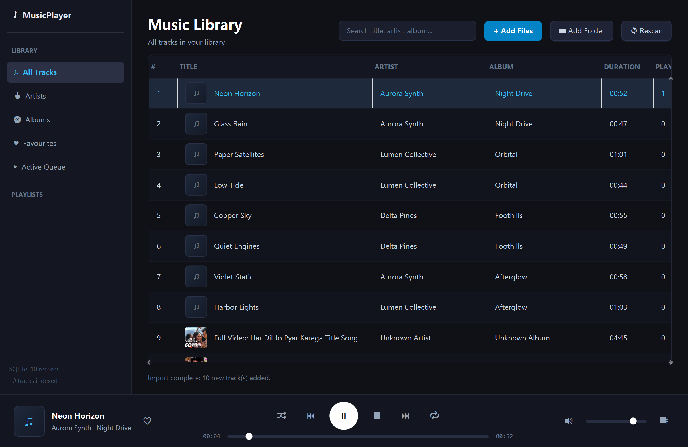 | 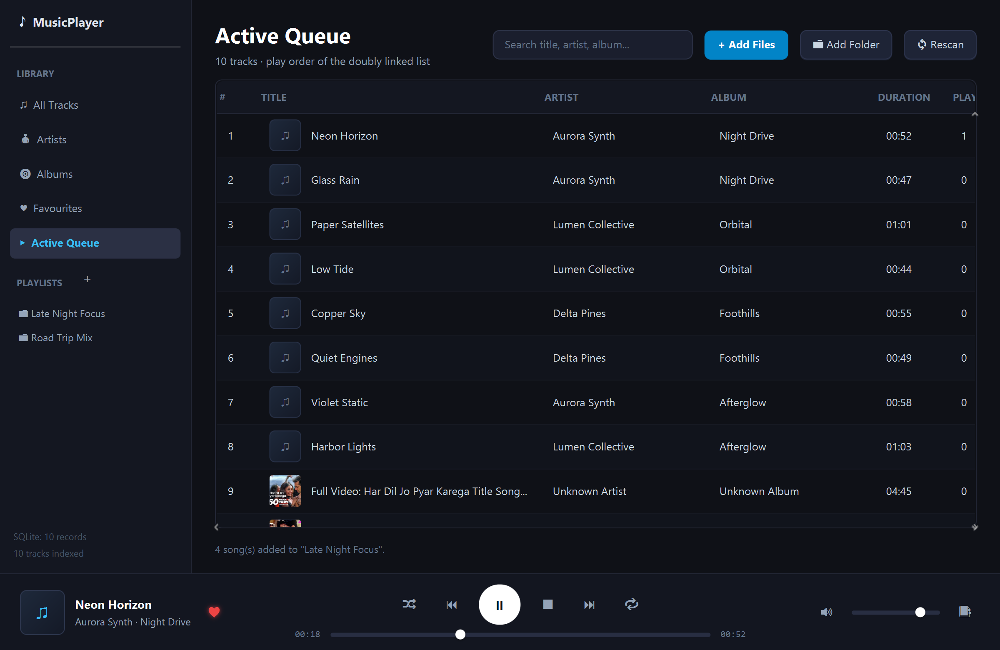 |
| *Dark-themed JavaFX dashboard during active playback with reactive transport bar, seek slider, and library index status.* | *Active Queue view displaying the exact traversal order maintained by the Doubly Linked List (`PlaybackQueue`).* |

| Playlist Management View | Instant Search Filtering |
| :---: | :---: |
| 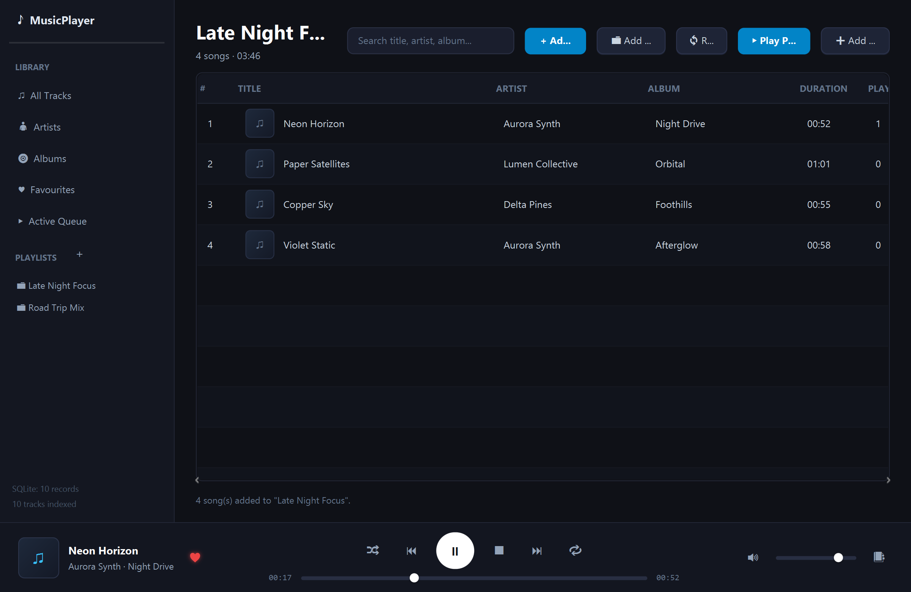 | 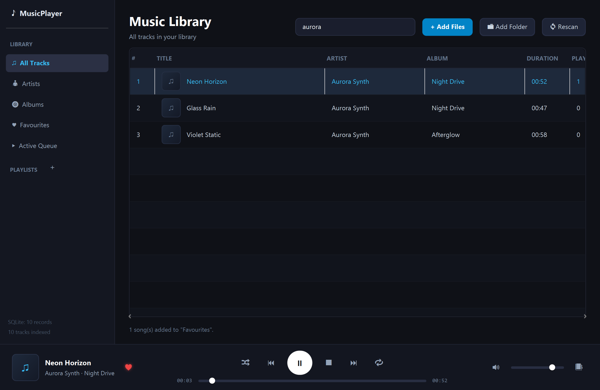 |
| *Custom playlist view (`Late Night Focus`) showing track count, cumulative duration, and playlist-specific controls.* | *Real-time filtering by title, artist, or album in memory without issuing blocking database queries.* |

---

## 3. System Architecture (MVC)

The desktop engine follows an event-driven **Model–View–Controller (MVC)** architecture cleanly separating UI presentation, observable state, audio/queue engines, and persistence:

<p align="center">
  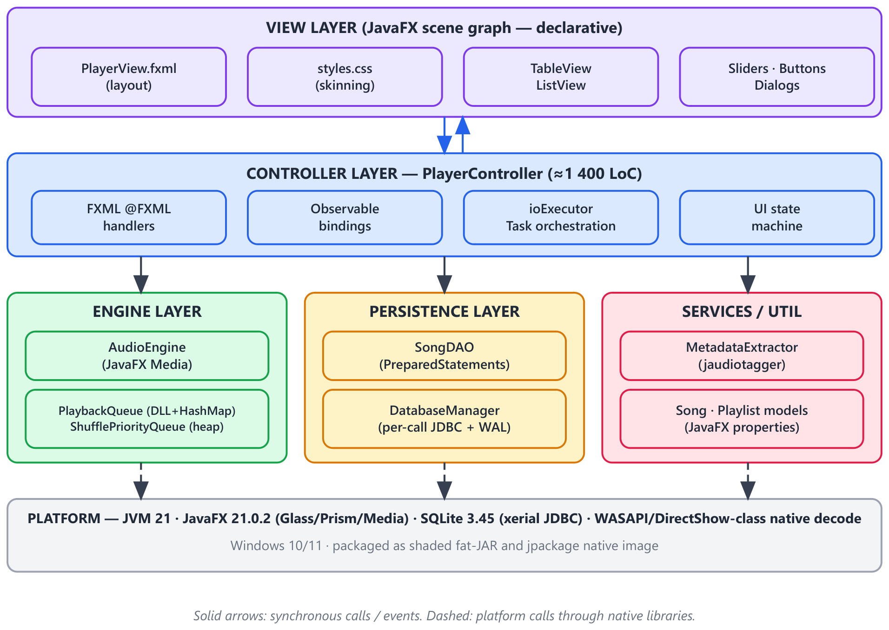
</p>

- **View (`PlayerView.fxml`, `styles.css`)**: Declarative JavaFX scene graph and CSS skinning (`TableView`, `ListView`, playback transport bar, seek/volume sliders, and dialogs) bound reactively to observable properties.
- **Controller (`PlayerController.java`)**: Coordinates user interactions, enforces the `isSeeking` seek-bar drag guard, dispatches background `Task`s onto `ioExecutor`, and bridges the View with `AudioEngine`, `PlaybackQueue`, `ShufflePriorityQueue`, and `SongDAO`.
- **Model (`Song.java`, `Playlist.java`)**: Observable JavaFX property models representing track metadata, duration, play counts, and playlist membership.
- **Engine (`AudioEngine.java`, `PlaybackQueue.java`, `ShufflePriorityQueue.java`)**: Manages asynchronous `MediaPlayer` lifecycles, $O(1)$ queue traversal/splicing, and weighted $O(\log n)$ shuffle ordering.
- **Persistence & Utilities (`DatabaseManager.java`, `SongDAO.java`, `MetadataExtractor.java`)**: Handles per-call JDBC SQLite connections in WAL mode and `jaudiotagger` ID3/RIFF metadata extraction.

---

## 4. Core Data Structures, Algorithms & Concurrency

### 4.1 O(1) Doubly Linked List + HashMap Play Queue (`PlaybackQueue`)

Standard array-backed lists (`ArrayList`) incur $O(n)$ shifting overhead when inserting a track mid-queue or removing an arbitrary song. `PlaybackQueue` fuses a custom **Doubly Linked List** (`LinkedListNode<Song>`) with a path-keyed **`HashMap<String, LinkedListNode<Song>>` (`pathIndex`)**:

<p align="center">
  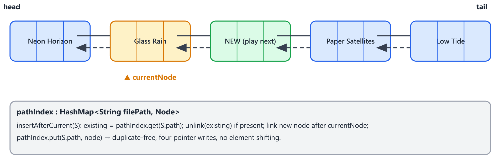
</p>

- **`insertAfterCurrent(Song)` (*Play Next*)**: Checks `pathIndex` in $O(1)$ to move an existing node rather than duplicating it, then updates four node pointers (`currentNode.next`, `node.prev`, `node.next`, `after.prev`) in **$O(1)$ constant time**.
- **`removeNode(LinkedListNode<Song>)`**: Unlinks any node directly via `prev`/`next` references and removes its key from `pathIndex` in **$O(1)$**.
- **`getNext()` / `getPrevious()`**: Advances or steps backward in **$O(1)$** with optional `repeatAll` wrap-around.

#### Empirical Queue Benchmark (`PlaybackQueue` vs. `ArrayList`, Report Chapter 4 Benchmarks)

| Queue Size ($n$) | DLL 1,000 *Play Next* (ms) | `ArrayList.add(mid)` 1,000× (ms) | DLL 200 Removals (ms) | `ArrayList.remove(Object)` 200× (ms) |
| :---: | :---: | :---: | :---: | :---: |
| **1,000** | **0.17 ms** | 0.31 ms | **0.03 ms** | 5.04 ms |
| **10,000** | **0.35 ms** | 0.64 ms | **0.18 ms** | 36.22 ms |
| **100,000** | **0.19 ms** | 5.19 ms | **0.12 ms** | 341.61 ms |

| Play-Next Insertion Cost vs. Queue Size | Removal-by-Reference Cost vs. Queue Size |
| :---: | :---: |
| 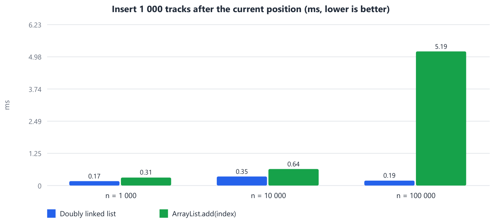 | 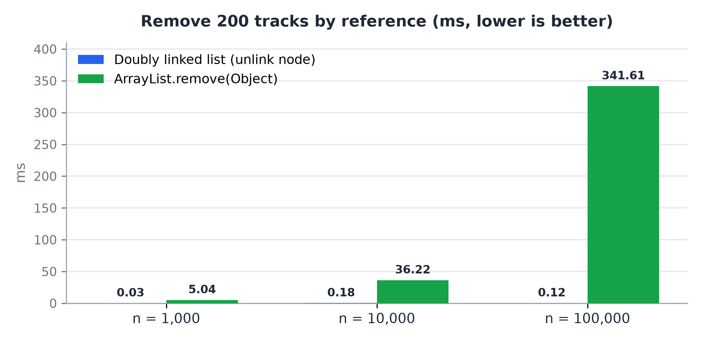 |

---

### 4.2 Weighted Binary Max-Heap Shuffle (`ShufflePriorityQueue`)

Memoryless uniform random shuffle can repeat recently played tracks while leaving unplayed songs unheard. `ShufflePriorityQueue` implements an array-backed **Binary Max-Heap** that prioritizes lesser-played tracks while injecting controlled entropy:

<p align="center">
  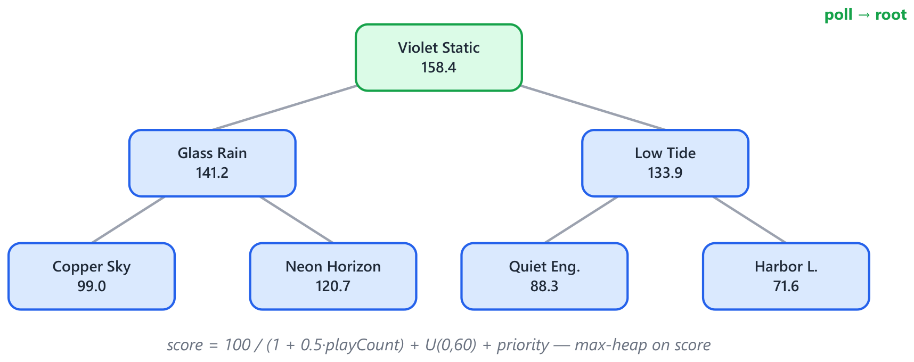
</p>

Each song receives an ephemeral score upon insertion (`ShufflePriorityQueue.java`):

$$\text{score} = \frac{100.0}{1.0 + 0.5 \times \text{playCount}} + U(0,\,60.0) + \text{priority}$$

- **Inversely Weighted Play Count**: Unplayed tracks (`playCount = 0`) receive a base weight of `100.0`, while heavily played tracks decay smoothly.
- **Controlled Random Jitter**: Adding `random.nextDouble() * 60.0` keeps the shuffle order unpredictable and fresh across sessions.
- **Asymptotic & Measured Speed**: `insert()` and `pollNext()` run in **$O(\log n)$** (`rebuild(n)` at $n = 100{,}000$ takes **13.41 ms**, draining all $100{,}000$ nodes takes **42.31 ms**, and **100.0%** of the first 10% drawn are unplayed songs when mixed with played songs).

---

### 4.3 Token-Guarded Concurrency & Seek Drag Guard (`AudioEngine`, `PlayerController`)

<p align="center">
  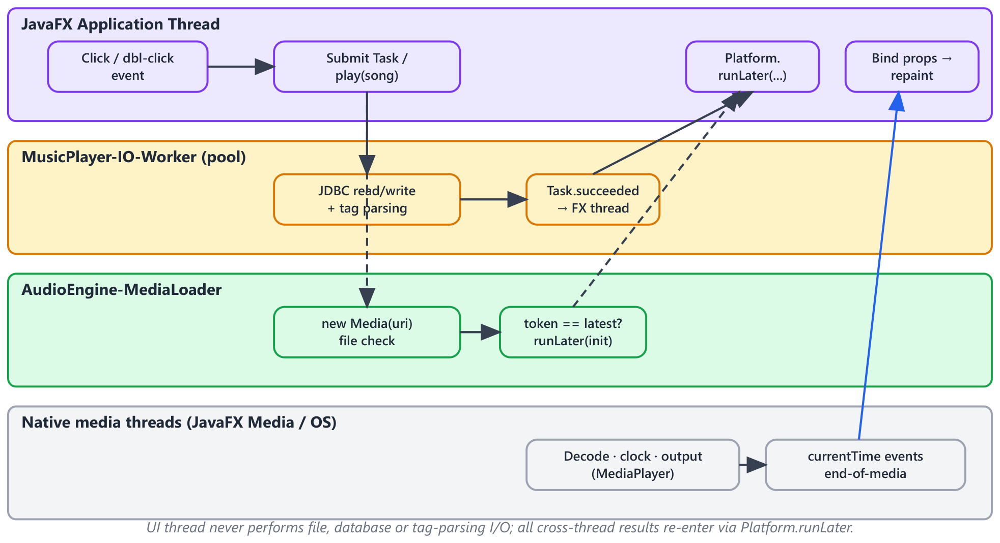
</p>

All blocking work is strictly confined off the **JavaFX Application Thread**:
1. **`MusicPlayer-IO-Worker` Pool**: Handles folder traversal, `jaudiotagger` tag/artwork parsing, and SQLite reads/writes via JavaFX `Task`s.
2. **`AudioEngine-MediaLoader` Single-Thread Executor**: Verifies file existence and instantiates `Media` off the UI thread.
3. **`AtomicLong loadToken` Protocol (Rapid *Next* Guard)**: Every `AudioEngine.play(song)` call increments a monotonic `loadToken`. When the background loader finishes and dispatches `Platform.runLater(...)`, it calls `initMediaPlayer(...)` **only if `token == loadToken.get()`**—discarding stale out-of-order loads so rapid *Next* clicks never produce overlapping audio (**25 / 25** 8-click burst tests won cleanly by the final track).
4. **Seek-Bar Drag Guard (`isSeeking`)**: In `PlayerController.setupSeekSlider()`, pressing the mouse sets `isSeeking = true`, temporarily suppressing real-time `currentPositionSeconds` slider updates while the user drags. Only on mouse release (`setOnMouseReleased`) is `isSeeking` cleared and a single `audioEngine.seek(...)` issued—preventing hundreds of conflicting seek calls to the decoder.

---

### 4.4 Transactional SQLite 3.45 Persistence in WAL Mode (`DatabaseManager`, `SongDAO`)

<p align="center">
  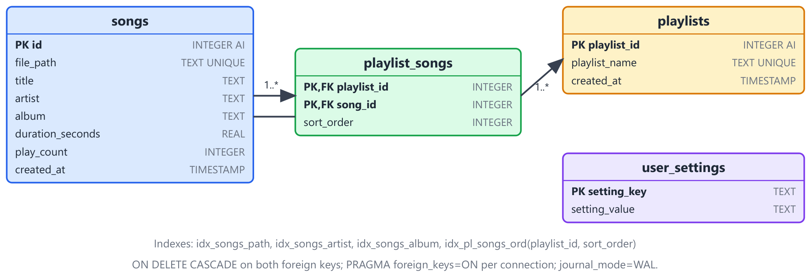
</p>

- **3NF Local Schema (`~/.musicplayer/music_player.db`)**: Four tables (`songs`, `playlists`, `playlist_songs` junction with `ON DELETE CASCADE`, and `user_settings`) indexed on `file_path`, `artist`, `album`, and `(playlist_id, sort_order)`.
- **SQLite Write-Ahead Logging (`?journal_mode=WAL&synchronous=NORMAL`)**: Enables concurrent readers and non-blocking writes so audio playback and UI queries continue smoothly during library imports.
- **Per-Call Independent Connections**: `DatabaseManager.getConnection()` returns a fresh JDBC connection per operation (and `SongDAO.getAllPlaylists()` closes its outer `ResultSet` before querying per-playlist tracks), eliminating `stmt pointer is closed` race conditions across worker threads.
- **Measured Persistence Speed (2,000 synthetic rows through `SongDAO`)**: `getAllSongs()` completes in **10.4 ms**, indexed `getSongByPath()` takes **1.46 ms**, and individual `insertOrUpdateSong()` upserts average **4.77 ms / row**.

---

## 5. Empirical Performance & Verification

All measurements below were captured on **Windows 11 (24 logical cores)** running **OpenJDK 21.0.12.1** and **JavaFX 21.0.2**:

| CPU Consumption by Phase | JVM Heap vs. OS Working Set |
| :---: | :---: |
| 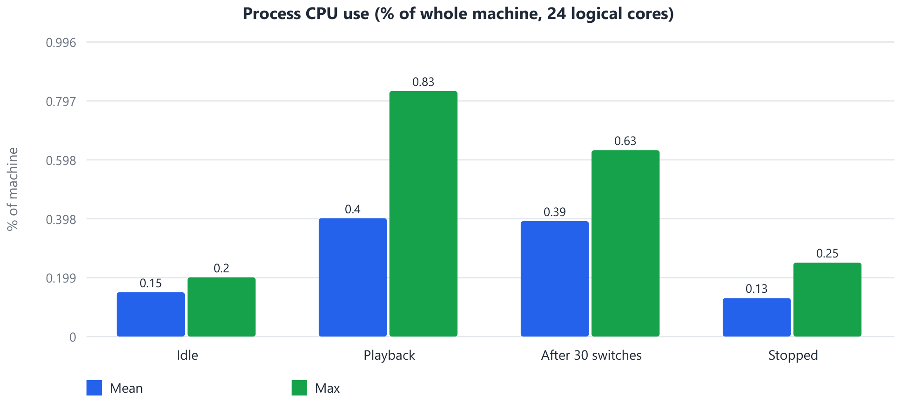 | 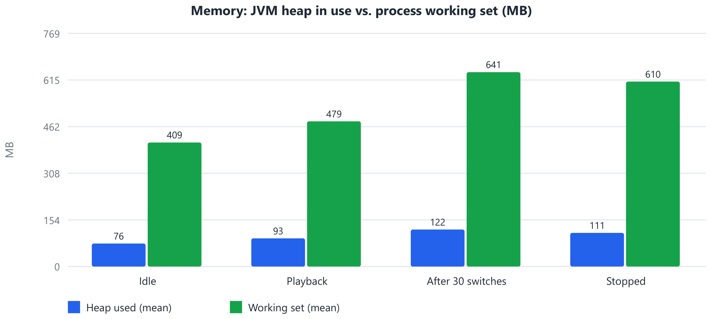 |

| Track-Switch Latency Across 30 Trials (`play()` to `PLAYING`) |
| :---: |
| 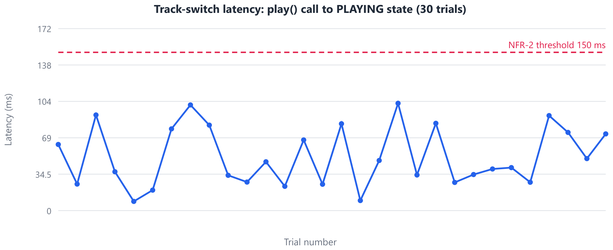 |

| Phase / Benchmark | Key Measured Values | Verification |
| :--- | :--- | :---: |
| **Idle (15 s)** | **0.15%** CPU mean (`0.20%` max), **76 MB** heap used (`409 MB` working set) | Verified |
| **Active Playback (30 s)** | **0.40%** CPU mean (`0.83%` max), **93 MB** heap used (`479 MB` working set) | Verified |
| **30 Track Switches** | **0.06 ms** mean UI block (`0.22 ms` max); **46.22 ms** median / **90.59 ms** P95 to `PLAYING` | Verified |
| **Burst Rapid-Skip (`TokenStress`)** | **25 / 25** rounds of 8 rapid `play()` calls converged to final track (`0` failures) | Verified |
| **Thread-Safety & Drag Guard** | `0` `stmt pointer is closed` errors; single clean `seek()` committed on slider release | Verified |

---

## 6. Project Structure

```text
musicplayer-desktop-engine-&-suite/
├── music-player/                           # Native Java 21 + JavaFX 21 Desktop Application
│   ├── pom.xml                             # Maven build (JavaFX 21.0.2, SQLite 3.45.1, jaudiotagger 3.0.1)
│   ├── BUILD_AND_PACKAGING_GUIDE.md        # Fat-JAR & jpackage Windows .exe instructions
│   └── src/main/
│       ├── java/com/musicplayer/
│       │   ├── Launcher.java               # Fat-JAR / jpackage entry point
│       │   ├── MainApp.java                # JavaFX stage, stylesheet, graceful executor shutdown
│       │   ├── controller/
│       │   │   └── PlayerController.java   # MVC controller, bindings, ioExecutor tasks, seek drag guard
│       │   ├── engine/
│       │   │   ├── AudioEngine.java        # Async MediaLoader + AtomicLong token-guarded playback
│       │   │   ├── PlaybackQueue.java      # O(1) Doubly Linked List + HashMap path index
│       │   │   └── ShufflePriorityQueue.java # Binary Max-Heap weighted shuffle
│       │   ├── database/
│       │   │   ├── DatabaseManager.java    # SQLite WAL connection factory & 3NF DDL
│       │   │   └── SongDAO.java            # Synchronized PreparedStatement CRUD & upserts
│       │   ├── model/
│       │   │   ├── Song.java               # Observable song metadata & play count properties
│       │   │   └── Playlist.java           # Playlist model
│       │   └── util/
│       │       └── MetadataExtractor.java  # ID3/RIFF metadata & artwork extraction (jaudiotagger)
│       └── resources/
│           ├── fxml/PlayerView.fxml        # Declarative JavaFX UI layout
│           └── css/styles.css              # Dark-theme JavaFX styling
├── src/                                    # Interactive React 19 + TypeScript Web Simulator & Lab
│   ├── App.tsx                             # Tabbed Simulator, Data Structures Lab, DB Explorer, Code & Packaging
│   ├── components/                         # DesktopPlayerSimulator, DataStructuresLab, DatabaseExplorer, etc.
│   ├── data/sourceCode.ts                  # Embedded Java source reference browser
│   └── utils/dataStructures.ts             # TypeScript simulation of PlaybackQueue & PriorityQueue
├── docs/images/                            # Architecture diagrams, UI screenshots & benchmark graphs
├── documentation.md                        # Deep-dive technical source documentation
├── implementation.md                       # Architecture & implementation overview
├── TEST_REPORT.md                          # v1.1 compile, thread-safety & feature verification report
├── RunMusicPlayer.bat                      # Windows quick launcher for packaged shaded JAR
├── package.json                            # Web suite dependencies (React 19, Vite 8, Tailwind CSS 4)
└── README.md
```

---

## 7. Getting Started

### Option A: Native JavaFX Desktop Player (`music-player/`)

**Prerequisites:** JDK 21 (Eclipse Temurin / OpenJDK 21+) and Apache Maven 3.9+.

```bash
cd music-player
mvn clean compile javafx:run
```

#### Build a Standalone Shaded Fat JAR
```bash
cd music-player
mvn clean package
# Produces target/music-player-1.0.0-all.jar
```

#### Package as a Native Windows `.exe` via `jpackage`
See [`music-player/BUILD_AND_PACKAGING_GUIDE.md`](music-player/BUILD_AND_PACKAGING_GUIDE.md) for full `jpackage` instructions (`--type app-image` portable app or `--type exe` installer with WiX Toolset).

---

### Option B: Interactive Web Simulator & Data Structures Lab (`src/`)

**Prerequisites:** Node.js 18+ (or Bun).

```bash
npm install
npm run dev
```

---

## 8. Future DSP Roadmap

Feasibility micro-benchmarks in the project report established that a 2,048-point Radix-2 FFT with Hann windowing completes in **124.56 µs** (~8,028 transforms/s) and a 52 s stereo waveform envelope reduces to 1,000 bins in **17.17 ms**. Future releases (`v1.2+`) will introduce an extensible PCM sample-tap DSP pipeline:

<p align="center">
  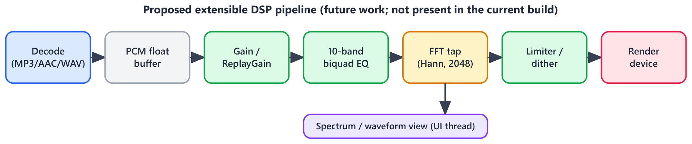
</p>

- **10-Band Parametric Biquad Equalizer** (cascaded IIR biquad filters)
- **Real-Time 60 Hz FFT Spectrum & Waveform Visualizer**
- **Extended Lossless Codec Support** (`FLAC`, `OGG Vorbis`, `Opus`)
- **ITU-R BS.1770 / EBU R128 ReplayGain Loudness Normalization**
- **Global OS Media Keys, Mini-Player Mode & Synced Lyrics**
